# Documentação Geral — **Nosso Voto**

> **Plataforma Web (Mobile-First & Desktop) de Gestão de Casamentos, Inspirações e Lista de Presentes**  
> **Diretório do Projeto:** `/root/projetos/nosso-voto`  
> **Ambiente:** 100% Docker (`PHP 8.5` + `Laravel 13` + `Livewire 4` + `Tailwind CSS` + `PostgreSQL 18`)

---

## 1. Visão Geral do Produto
O **Nosso Voto** é uma plataforma web projetada para noivos e noivas organizarem o casamento de ponta a ponta em um só lugar — conectando **orçamento integrado a fornecedores**, **checklist e lista de itens para o grande dia**, **referências visuais capturadas direto do Pinterest**, **colaboração com o cerimonialista** e **lista de presentes convertida em dinheiro via Pix/Cartão**.

A arquitetura e o escopo priorizam um **MVP enxuto para desenvolvedor solo**, com baixíssimo custo operacional, crescimento orgânico/viral via fornecedores e geração de receita previsível desde os primeiros casamentos.

---

## 2. Identidade Visual & Experiência (UI/UX)
- **Paleta Escolhida:** **Terracota & Areia**
  - **Fundo principal:** `#FBF9F7` (Areia clara / linho)
  - **Superfícies / Cards:** `#FFFFFF` (Branco puro)
  - **Cor primária / destaque:** `#C25E38` (Terracota — variação hover `#A84D2B`, fundo suave `#F9EBE6`)
  - **Texto principal:** `#2C2523` (Marrom espresso — texto secundário `#6E625F`)
- **Diretrizes de Interface:**
  - Design limpo, acolhedor e de fácil uso.
  - **Mobile-first** (navegação por barra inferior no celular + suporte instalável via **PWA**) e **Desktop** (navegação lateral e painéis amplos).
  - Regras completas de boas práticas do painel em [docs/DIRETRIZES_DASHBOARD.md](DIRETRIZES_DASHBOARD.md) (incluindo separação entre Landing/Guest/Dashboard e ausência de selos *"100% Gratuito"* dentro do painel logado).

---

## 3. Modelo de Negócio e Monetização

### 3.1. Noivos / Casal — 100% Gratuito
- Cadastro, planejamento de orçamento, organização de fornecedores, checklist do grande dia, captura de inspirações do Pinterest e criação da lista de presentes são **totalmente gratuitos** para o casal, maximizando a entrada de usuários na plataforma.

### 3.2. Lista de Presentes em Dinheiro (Receita Principal Rápida)
- Os convidados compram cotas ou presentes simbólicos (ex.: *Cota Lua de Mel*, *Jantar Romântico*) pagos via **Pix ou Cartão de Crédito**, deixando mensagens carinhosas para os noivos.
- **Taxa da Plataforma (ex.: `4,99%` configurável):**
  - Os noivos escolhem com **1 clique** no painel entre:
    1. **Repassar a taxa ao convidado:** o valor da taxa é somado no checkout do convidado e os noivos recebem **100%** do valor base do presente.
    2. **Absorver a taxa:** o convidado paga exatamente o valor base exibido e a porcentagem da plataforma é descontada antes de creditar o saldo dos noivos.
- **Fluxo Financeiro (Carteira + Resgate via Pix):**
  - Arquitetura preparada para integração com gateway (**Asaas** ou **Mercado Pago**).
  - O saldo líquido fica disponível na **Carteira do Casal** no painel e é resgatado via **Chave Pix** cadastrada, evitando burocracia de abertura de subconta/KYC logo no cadastro inicial.

### 3.3. Fornecedores — Presença Gratuita + Monetização Regional Justa
- **Entrada Híbrida (Vitrine + Convite Viral):**
  - Fornecedores podem se cadastrar gratuitamente na Vitrine da plataforma.
  - Quando os noivos cadastram um fornecedor externo manualmente, o sistema gera um **Link de Convite exclusivo** para aquele profissional acessar o casamento — trazendo novos fornecedores organicamente para a base.
- **1) Assinatura Mensal de Destaque Regional (Cidade/UF + Categoria):**
  - Posiciona o fornecedor no topo das buscas dos noivos naquela cidade/região com selo de destaque e botão direto de WhatsApp.
  - **Regra de Equidade (Ordem Randômica):** Quando há múltiplos fornecedores destacados na mesma região/categoria, a listagem é exibida em **ordem randômica (`ORDER BY is_regional_highlight DESC, RANDOM()`)** a cada carregamento para não dar privilégios fixos a nenhum assinante.
- **2) Banner Principal (Super Destaque por Período):**
  - Espaço nobre em destaque no topo do sistema com **no máximo 5 fornecedores simultâneos** por ciclo/região.
  - Contratado por **período fixo configurável pela plataforma** (ex.: **ciclos de 2 meses**), onde todos os fornecedores interessados podem submeter candidatura e pagar pelo ciclo enquanto houver vagas (`<= 5`).
- **3) Portfólio Pago com Sincronização do Instagram:**
  - O cadastro básico gratuito do fornecedor exibe apenas informações essenciais (nome, categoria, cidade/UF e contato).
  - A exibição de **Portfólio (galeria de trabalhos na Vitrine)** é uma **funcionalidade paga** no painel do fornecedor.
  - Ao ativar o Portfólio Pago, o profissional pode fazer upload manual de fotos **e conectar sua conta do Instagram** para **sincronizar automaticamente** suas publicações recentes (fotos, carrosséis e legendas) com 1 clique ou de forma periódica.
- **4) Acesso às Inspirações do Pinterest (Feature Flag Liga/Desliga):**
  - A cobrança para **Decorador**, **Maquiadora** e **Penteadista** desbloquearem as pastas de inspiração salvas pela noiva ficará **suspensa/desativada inicialmente no MVP** (`paywall_pinterest_inspirations_enabled = false`) para não travar a adoção inicial, porém já modelada como uma **chave liga/desliga** no painel administrativo caso se decida ativar futuramente.

---

## 4. Perfis de Acesso e Funcionalidades

| Perfil | Responsabilidades e Recursos |
| :--- | :--- |
| **Noivos / Casal** | • **Orçamento Integrado aos Fornecedores:** definição de orçamento pretendido total; cada fornecedor registra *Teto Previsto*, *Valor Fechado* e *Valor Pago*, alimentando indicadores de *Orçamento vs. Gasto* e alertas de estouro. • **Checklist & Lista do Grande Dia:** lista organizada por categorias de tudo o que o casal precisa para o casamento (itens físicos, trajes, documentação e preparativos), podendo marcar o que **já tem**, o que está **completando aos poucos** (com controle de quantidades, ex.: *15 de 30 lembrancinhas*) e o que **ainda falta**, com barra de progresso geral. • **Autonomia Total de Cadastro:** podem vincular fornecedores da Vitrine **ou cadastrar manualmente qualquer fornecedor externo que não use a plataforma** (registrando valores, parcelas, contato e observações do contrato). • **Links de Convite:** geração opcional de link exclusivo para convidar o profissional a colaborar. • **Central de Inspirações Pinterest:** pastas organizadas por *Decoração*, *Maquiagem* e *Penteado* + notas da noiva. • **Lista de Presentes & Carteira Pix:** criação de cotas, escolha da regra de taxa, mural de recados e solicitação de resgate via Pix. |
| **Cerimonialista** | • **Visão Consolidada e Colaborativa:** acessa pelo link de convite a lista unificada de todos os fornecedores do casal, seus status (*Em Cotação*, *Contratado*, *Quitado*), contatos e observações, podendo **atualizar status, contatos e adicionar notas/fornecedores** para apoiar os noivos, além de acompanhar e conferir os itens da lista do grande dia junto aos noivos. |
| **Decorador** | • Visualiza o moodboard de **Decoração** salvo pela noiva no Pinterest (respeitando autorização do casal e a feature flag global de paywall). |
| **Maquiadora e Penteadista** | • Visualizam o moodboard de **Maquiagem** e **Penteado** salvo pela noiva no Pinterest, com observações e links originais dos pins. |
| **Fornecedor (Portal & Agenda)** | • **Agenda de Próximos Noivos:** visualização cronológica dos próximos casamentos e eventos fechados ou em negociação (com data, nomes dos noivos, local, status e valores do contrato). • **Autonomia Total de Cadastro:** mesmo que os noivos **não utilizem a plataforma**, o fornecedor pode cadastrar manualmente os dados do casal, data do casamento, cidade/local, valor fechado, valor pago e observações na sua agenda. • **Portfólio Pago & Sync Instagram:** área dedicada para ativar o módulo pago de portfólio, gerenciar fotos dos trabalhos e conectar a conta do **Instagram** para sincronização automática do feed. • **Vitrine & Destaques:** gestão do perfil público, contratação/ativação do **Destaque Regional** e submissão para uma das **5 vagas do Banner** do ciclo vigente (ex: 2 meses). |
| **Admin / Plataforma** | • Painel de configuração de taxas (%), valores dos planos, duração do ciclo do banner, gestão das 5 vagas do banner e controle da **Feature Flag** de cobrança das inspirações. |

---

## 4.1. Autonomia Bidirecional & Agenda (Independência Noivos ↔ Fornecedores)
Para evitar qualquer barreira de adoção ("efeito ovo e galinha"), **noivos e fornecedores não dependem um do outro para usar o sistema**:

1. **Quando o fornecedor NÃO usa a plataforma:**
   - Os noivos cadastram livremente o contrato do fornecedor em seu painel (`vendor_profile_id = null`), controlando Teto Previsto, Valor Fechado, Valor Pago, status e anotações.
   - Opcionalmente, podem gerar um link de convite para que o profissional passe a acompanhar o casamento depois.
2. **Quando os noivos NÃO usam a plataforma:**
   - O fornecedor cadastra livremente os atendimentos na sua **Agenda de Próximos Noivos** (`wedding_id = null`), informando nomes do casal, data do casamento, cidade/local, contato, valor contratado, pagamentos recebidos e observações.
   - A agenda consolida automaticamente em uma única linha do tempo tanto os casamentos vinculados pela plataforma quanto os casamentos cadastrados manualmente pelo próprio fornecedor.
3. **Quando ambos passam a usar a plataforma:**
   - Um registro manual pode ser vinculado ao `Wedding` ou ao `VendorProfile` correspondente (mediante aceite/convite), mantendo o histórico financeiro de forma independente para cada lado sem sobrescrever informações privadas (ex.: Teto Previsto dos noivos).

---

## 5. Captura de Inspirações do Pinterest (Sem Burocracia de OAuth)
Para garantir custo zero e zero dependência de aprovação burocrática da API oficial do Pinterest no MVP, a captura funcionará por **três canais complementares**:

1. **Colagem Direta de Link no Painel Web:** a noiva cola o link de um Pin ou Pasta do Pinterest, escolhe a categoria (*Decoração*, *Maquiagem* ou *Penteado*) e escreve suas notas.
2. **Extensão do Google Chrome (Manifest V3):** um *Content Script* injeta um botão flutuante em Terracota (**"Salvar no Nosso Voto"**) diretamente sobre os pins enquanto a noiva navega no Pinterest. Ao clicar, escolhe a categoria e salva direto via endpoint REST `POST /api/v1/inspirations/clip` autenticado pelo `api_token` do casal.
3. **PWA Web Share Target (Celular):** configurado em `public/manifest.json` apontando para `/compartilhar-pin`. Com o Nosso Voto instalado no celular, ao tocar em *Compartilhar* dentro do app oficial do Pinterest, o Nosso Voto aparece como destino nativo e pré-preenche o link para salvar com 1 toque.

---

## 6. Arquitetura Técnica & Stack Docker

| Camada | Tecnologia / Versão | Papel |
| :--- | :--- | :--- |
| **Container Runtime** | Docker + Docker Compose | Isolamento completo sem dependências no host |
| **Linguagem Backend** | PHP `8.5` (`php:8.5-cli-alpine`) | Runtime mais recente com `pdo_pgsql`, `pgsql`, `intl`, `bcmath`, `zip`, `mbstring` |
| **Framework Web** | Laravel `13.x` | Roteamento, Eloquent ORM, Migrations, API REST, CORS, Sessões e Filas |
| **Interface Reativa** | Livewire `4.x` | Componentes interativos server-driven sem complexidade de SPA separada |
| **Estilização** | Tailwind CSS | Tokens customizados da paleta *Terracota & Areia* (`#FBF9F7` / `#C25E38` / `#2C2523`) |
| **Banco de Dados** | PostgreSQL `18` (`postgres:18-alpine`) | Banco relacional com suporte nativo a transações, locks e ordenação `RANDOM()` |
| **Extensão & Mobile** | Chrome Extension MV3 + PWA Manifest | Captura 1-clique no Pinterest (desktop e mobile) |

---

## 7. Modelagem Conceitual do Banco de Dados (ERD Planejado)

```mermaid
erDiagram
    USERS ||--o| WEDDINGS : "possui"
    USERS ||--o{ VENDOR_PROFILES : "gerencia"
    WEDDINGS |o--o{ WEDDING_VENDORS : "contrata (opcional)"
    VENDOR_PROFILES |o--o{ WEDDING_VENDORS : "agenda/vincula (opcional)"
    VENDOR_PROFILES ||--o{ VENDOR_PORTFOLIO_ITEMS : "exibe (recurso pago)"
    WEDDINGS ||--o{ WEDDING_CHECKLIST_ITEMS : "organiza"
    WEDDINGS ||--o{ PINTEREST_INSPIRATIONS : "salva"
    WEDDINGS ||--o{ GIFT_ITEMS : "oferece"
    WEDDINGS ||--o{ GIFT_PURCHASES : "recebe"
    GIFT_ITEMS ||--o{ GIFT_PURCHASES : "gera"
    WEDDINGS ||--o{ WALLET_WITHDRAWALS : "resgata via Pix"
    BANNER_CYCLES ||--o{ BANNER_SUBMISSIONS : "recebe (max 5 ativas)"
    VENDOR_PROFILES ||--o{ BANNER_SUBMISSIONS : "submete"

    PLATFORM_SETTINGS {
        bigint id PK
        boolean paywall_pinterest_inspirations_enabled "Chave Liga/Desliga (default false)"
        decimal platform_gift_fee_percent "Taxa Lista de Presentes (ex: 4.99)"
        decimal regional_highlight_monthly_price "Valor Destaque Regional"
        decimal portfolio_monthly_price "Valor Portfolio Pago"
        int banner_cycle_months "Duracao ciclo banner (ex: 2)"
        int banner_max_slots "Maximo de vagas no banner (5)"
        decimal banner_cycle_price "Valor do periodo no banner"
    }

    USERS {
        bigint id PK
        string name
        string email UK
        string password
        string role "couple | vendor | admin"
        string api_token UK "Token da Extensao Chrome"
    }

    WEDDINGS {
        bigint id PK
        bigint user_id FK
        string slug UK
        string partner_1_name
        string partner_2_name
        date wedding_date
        string city
        string state
        decimal estimated_budget
        string gift_fee_mode "pass_to_guest | absorb"
        string pix_key_type
        string pix_key
        decimal wallet_balance_available
        decimal wallet_total_received
        decimal wallet_total_withdrawn
    }

    VENDOR_PROFILES {
        bigint id PK
        bigint user_id FK
        string business_name
        string slug UK
        string category
        string city
        string state
        string whatsapp
        string instagram
        boolean is_regional_highlight
        timestamp highlight_expires_at
        boolean has_paid_portfolio "Recurso pago de Portfolio"
        timestamp portfolio_expires_at
        text instagram_access_token "Token criptografado (Meta API)"
        timestamp instagram_last_synced_at
    }

    VENDOR_PORTFOLIO_ITEMS {
        bigint id PK
        bigint vendor_profile_id FK
        string source "instagram | manual"
        string instagram_media_id "ID unico da midia no Instagram"
        string media_type "IMAGE | CAROUSEL_ALBUM | VIDEO"
        text media_url
        text permalink
        text caption
        int display_order
        timestamp published_at
    }

    BANNER_CYCLES {
        bigint id PK
        string title
        string city
        string state
        int duration_months "Ex: 2 meses"
        int max_slots "Max 5"
        decimal price
        timestamp starts_at
        timestamp ends_at
        boolean is_active
    }

    BANNER_SUBMISSIONS {
        bigint id PK
        bigint banner_cycle_id FK
        bigint vendor_profile_id FK
        string headline
        string status "pending | active | waitlist | rejected"
        int slot_number "1..5"
        timestamp paid_at
    }

    WEDDING_VENDORS {
        bigint id PK
        bigint wedding_id FK "Nullable se cadastrado apenas pelo fornecedor"
        bigint vendor_profile_id FK "Nullable se cadastrado apenas pelos noivos"
        string created_by_side "couple | vendor"
        string vendor_name "Nome do fornecedor"
        string couple_names "Nome dos noivos (para agenda do fornecedor)"
        date event_date "Data do casamento (ordena a agenda)"
        string event_city
        string event_venue
        string category
        decimal estimated_amount "Teto Previsto (visao noivos)"
        decimal contracted_amount "Valor Fechado"
        decimal paid_amount "Valor Pago"
        string status "cotando | contratado | quitado"
        text notes
        string invite_token UK "Link exclusivo de convite/vinculo"
        boolean is_pinterest_authorized
        boolean has_paid_pinterest_unlock
    }

    WEDDING_CHECKLIST_ITEMS {
        bigint id PK
        bigint wedding_id FK
        string title
        string category "documentos_cerimonia | trajes_beleza | recepcao_festa | itens_grande_dia | convidados_convites | outros"
        string status "pendente | em_andamento | concluido"
        int quantity_needed "Quantidade necessaria (default 1)"
        int quantity_acquired "Quantidade que ja tem (default 0)"
        string assigned_to "partner_1 | partner_2 | ambos | cerimonialista"
        date due_date
        text notes
        timestamp completed_at
    }

    PINTEREST_INSPIRATIONS {
        bigint id PK
        bigint wedding_id FK
        string category "decoracao | maquiagem | penteado"
        string type "pin | board"
        string title
        text pinterest_url
        text image_url
        text bride_notes
        string source "web | chrome_extension | pwa_share"
    }

    GIFT_ITEMS {
        bigint id PK
        bigint wedding_id FK
        string title
        decimal base_price
        int quota_total
        int quota_sold
        boolean is_active
    }

    GIFT_PURCHASES {
        bigint id PK
        bigint wedding_id FK
        bigint gift_item_id FK
        string guest_name
        text guest_message
        string payment_method "pix | credit_card"
        decimal gross_amount
        decimal platform_fee_amount
        decimal net_couple_amount
        string fee_mode_snapshot
        string gateway_provider "asaas | mercadopago"
        string status
    }

    WALLET_WITHDRAWALS {
        bigint id PK
        bigint wedding_id FK
        decimal amount
        string pix_key_type
        string pix_key
        string status
    }
```

---

## 8. Roteiro de Implementação Gradual (Specs)
A documentação foi dividida em especificações incrementais dentro de `docs/specs/` (veja o guia completo em [docs/specs/README.md](specs/README.md)):

### Specs Arquivadas (Concluídas)
- **[Spec 00 — Setup Inicial Docker & Stack](specs/arquivadas/00-setup-inicial-docker-stack.md):** Ambiente Docker com PHP 8.5, Laravel 13, Livewire 4, Tailwind (paleta Terracota & Areia), PostgreSQL 18 e PWA base.
- **[Spec 01 — Autenticação, Perfis e Design System](specs/arquivadas/01-autenticacao-perfis-e-design-system.md):** `users`, `platform_settings` (feature flags) e layout base mobile-first + desktop.

### Specs Ativas (Implementação Gradual)
1. **[Spec 02 — Noivos: Orçamento e Contratos Autônomos](specs/ativas/02-noivos-orcamento-e-contratos-autonomos.md):** `weddings`, `wedding_vendors` (visão do casal sem depender do fornecedor) e geração de `invite_token`.
2. **[Spec 03 — Cerimonialista: Visão Consolidada e Colaborativa](specs/ativas/03-cerimonialista-visao-consolidada-colaborativa.md):** painel consolidado de fornecedores do casamento e edição colaborativa.
3. **[Spec 04 — Fornecedor: Agenda e Noivos Autônomos](specs/ativas/04-fornecedor-agenda-e-noivos-autonomos.md):** `vendor_profiles`, Agenda de Próximos Noivos e cadastro autônomo de casamentos externos pelo fornecedor.
4. **[Spec 05 — Inspirações Pinterest: Web, Chrome e PWA](specs/ativas/05-inspiracoes-pinterest-extensao-chrome-e-pwa.md):** pastas por especialidade, Extensão Chrome MV3, PWA Share Target e feature flag de paywall.
5. **[Spec 06 — Vitrine Regional, Destaque Randômico e Banner](specs/ativas/06-vitrine-regional-destaque-randomico-e-banner-ciclos.md):** busca regional randômica (`inRandomOrder()`) e ciclos de banner com limite máximo de 5 vagas.
6. **[Spec 07 — Fornecedor: Portfólio Pago e Sync Instagram](specs/ativas/07-fornecedor-portfolio-pago-e-sync-instagram.md):** galeria paga na Vitrine com importação automática de mídias do Instagram.
7. **[Spec 08 — Lista de Presentes, Taxas e Carteira Pix](specs/ativas/08-lista-de-presentes-taxas-e-carteira-pix.md):** página pública `/c/{slug}`, escolha de repasse/absorção de taxa e resgate via Chave Pix.
8. **[Spec 09 — Noivos: Checklist e Lista do Grande Dia](specs/ativas/09-noivos-checklist-e-itens-do-grande-dia.md):** controle prático de itens e preparativos do casamento com marcação do que falta, do que está completando e do que os noivos já têm.

